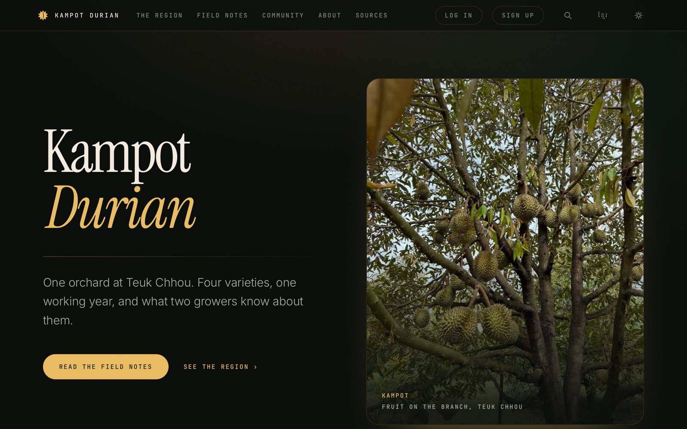
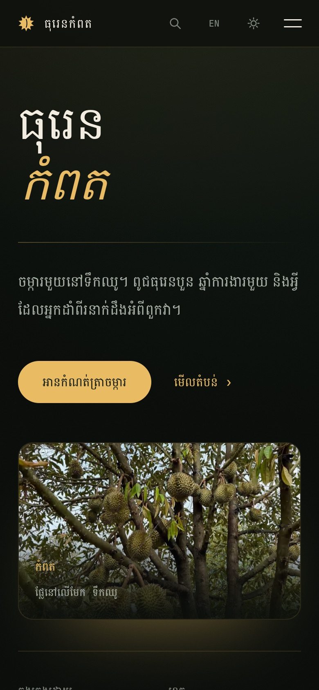
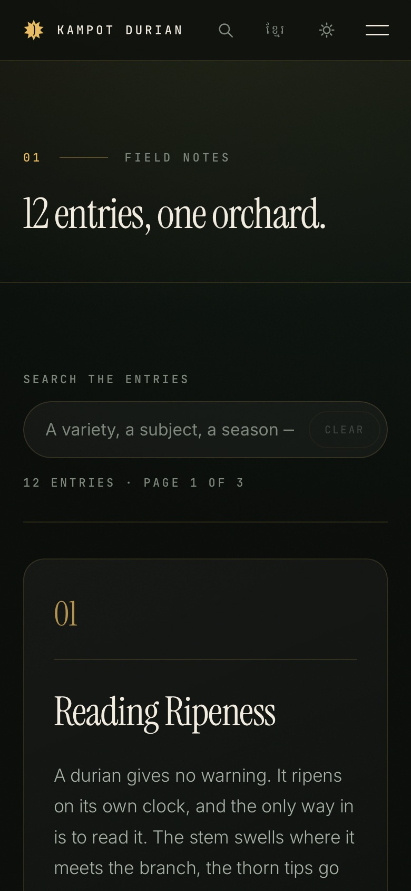

<div align="center">

# Kampot Durian

**A bilingual field guide to one family durian orchard in Kampot, Cambodia —
built from interviews, not the internet.**

[**Live site**](https://kampot-durian.vercel.app) ·
[**ខ្មែរ edition**](https://kampot-durian.vercel.app/km) ·
[**Sources & credits**](https://kampot-durian.vercel.app/sources) ·
[**Demo video**](https://youtu.be/4mGu9rXfeF0)





&nbsp;


</div>

Built by **Sovanpanha Nonn** for ICT 340 — Vibe Coding, American University of
Phnom Penh, Fall 2026.

### Features

- **Browse and search** 12 Field Notes, in English or Khmer, with a search
  that understands Khmer text.
- **Accounts:** anyone can sign up and add a Community Note with a photo.
- **Own your entries:** you can edit and delete only what you wrote.
- **Review before publish:** every new note waits in the curator's review
  queue; the database, not the page, decides who can publish.

### Contents

1. [What this is](#what-this-is)
2. [Who it's for](#who-its-for)
3. [How it works](#how-it-works)
4. [Security decisions](#security-decisions)
5. [AI use](#ai-use)
6. [Sources and credits](#sources-and-credits)
7. [Running it locally](#running-it-locally)
8. [Submission checklist](#submission-checklist) — for the course grader

---

## What this is

A field guide to one durian orchard at Teuk Chhou, Kampot — its varieties, its
season, how its growers read a fruit for ripeness, what a counterfeit looks
like on a highway stall, and what the 2024 drought cost them. Every word of it
came out of interviews with the family who work the land, and one neighbour.
A visitor can browse and search twelve Field Notes in English or Khmer; anyone
with an account can add a Community Note, which waits for the curator's review
before the public sees it.

**Primary sources only. Real people, asked directly. Nothing off the internet.**

> Every claim on this site comes from the family who own and work a
> durian orchard at Teuk Chhou, Kampot, or from the Khmer vocabulary they use
> in the field. No publication, news report, trade standard, research paper, or
> website is cited anywhere. Every photograph is the compiler's own; three
> pictures are AI-generated, and each one says so.

This is the third version of the site, and each rule replaced a worse one. v1
carried fabricated content — invented speakers, invented quotes, invented
recording dates — and was deleted outright. v2 rebuilt it from published
research and reporting with interview material threaded through. v3, this one,
removed the published half entirely: seventeen citations, every statistic that
came from a government series or a news report, and one licensed photograph.

The honest cost is that nothing here can be checked by a reader against an
outside source. The gain is that nothing here is second-hand, and two things on
it — the days from petal drop to harvest for four Cambodian varieties, and a
description of Sadong Kit — do not appear to exist anywhere else. That is why
`/about` has a section called "What is missing".

| Sprint | Feature | State |
|---|---|---|
| 1 | Browse and search | built |
| 2 | Contributor accounts, own-your-entries | built |
| 3 | Submit, review, publish | built — the gate, My notes, the review queue and take-down |

## Who it's for

Khmer readers first: people in Kampot and elsewhere in Cambodia who grow, buy
or sell durian, and anyone who wants to know how a Kampot grower judges a
fruit, in the grower's own words. English readers second. What was done for
them:

- **Khmer is a full edition, not a toggle on some pages.** Every page, button,
  status word, error message and the review queue exist in Khmer under `/km`.
  The translation uses the growers' own field terms (the knock test, the
  variety names as they are said), each confirmed by the curator, not
  dictionary guesses. Headings drop the Khmer full stop ។ because it looked
  wrong to Khmer eyes (the curator, 7 November 2026).
- **Khmer text behaves.** The Khmer fonts (Hanuman, Battambang) are
  self-hosted subsets, 92 KB together, preloaded only on `/km` pages.
  `scripts/khmer-breaks.mjs` marks where a Khmer line may break, since Khmer
  has no spaces between words. Search strips the invisible zero-width spaces
  some Khmer keyboards type, and a Khmer word finds its entry in either
  edition.
- **Phones first.** Every page is built and checked at 390 px wide, with a
  phone menu; the curator tests on their own phone before calling a change
  done.
- **Slow connections.** Pages are static, served ready-made from Vercel's
  cache and rebuilt in the background at most once a minute. The nav search
  loads its index only when it is opened. A contributor's photo is redrawn in
  the browser before upload — long edge at most 2400 px, JPEG, under 5 MB — so
  it costs less to send and carries no GPS location.
- **Sources named the way they asked.** Every entry ends with its sources.
  The orchard's owners asked not to be named and are credited as the curator's
  parents; the neighbour asked to be described rather than named. The farm's
  location and its water source are never published.

## How it works

Next.js 15 (App Router) and React 19 on Vercel, plain JavaScript; Supabase
for accounts, data and photos. **Five dependencies**: the framework three,
plus `@supabase/supabase-js` and `@supabase/ssr`, approved for Sprint 2 (see
`AGENTS.md`).

| | |
|---|---|
| Styling | one hand-written CSS file, `app/globals.css` — no framework |
| State | React's own `useState`; no state library |
| Data | Supabase Postgres, four tables (below), and a `photos` storage bucket |
| Auth | Supabase email and password |
| Search | a pure function over an array; no search library |

**Two editions.** English at the plain addresses, Khmer under `/km` — same
pages, same data. `middleware.js` maps English addresses onto `app/[lang]/`
without changing them; every string comes from `content/copy/`, with an `en`
and a `km` side.

### The tables

| Table | What it holds | Who writes it |
|---|---|---|
| `entries` | the twelve Field Notes | the curator only |
| `contributions` | Community Notes from every other account | their authors; status only through `review_entry()` |
| `profiles` | one display name per account | each person, their own row |
| `reviewers` | who may review (only the curator) | nobody through the site — the SQL Editor only |

### Statuses

A **Community Note** (`contributions.status`) is always one of three:

- `pending` — every new note, and every note its author edits. Only the author
  and the reviewer can see it.
- `published` — the reviewer published it. Everyone can see it.
- `returned` — the reviewer sent it back, with an optional note saying why;
  or took a published note down. Only the author and the reviewer can see it.
  The author edits it, and it goes back to `pending`.

A **Field Note** (`entries.status`) is `published` or `in-progress` (an entry
with an admitted gap). Anything else stays off the site. Field Notes are the
curator's own shelf and do not pass through the queue.

### Who may read and write what

Enforced by row-level security in the database, not by hiding buttons. Every
rule is in [`supabase/policies.sql`](supabase/policies.sql), a snapshot of the
live database.

- **Logged out:** read the Field Notes and published Community Notes; nothing
  else. Names are readable only for authors of a published note.
- **Any account:** add a Community Note, but only as `pending`, in its own
  name, with no review note. Edit or delete only its own notes; an edit must
  leave the note `pending`. Upload, list and delete photos only in its own
  folder of the `photos` bucket. Rename only itself.
- **Column grants** close what a policy alone would leave open: an author
  cannot write `review_note` or `created_at`, or change a note's owner or
  slug.
- **The reviewer** (a row in `reviewers`, checked by `is_reviewer()`) reads
  every note, and publishes, returns or takes down through `review_entry()`.
- **The curator** (`role: curator` in the account's app metadata, which a user
  cannot set) is the only account that writes Field Notes, and may delete any
  Community Note, but not rewrite one.
- **Check constraints** hold the form's rules again in the database: lengths,
  a known status, a photo URL inside the owner's own folder, a slug of
  `a-z0-9-` only, and display names that cannot fake the curator's tick.

### How it is laid out

```
middleware.js                English addresses → app/[lang]/ (lang "en"); /km as is
app/
  [lang]/layout.js           the root layout, per edition (html lang, fonts, metadata)
  [lang]/(home)/page.js      home — hero, featured entries, method note
  [lang]/region/ about/ sources/   the orchard; method and gaps; interviews and credits
  [lang]/field-notes/(index)/      browse + search over every entry, four to a page
  [lang]/field-notes/[slug]/       one entry; /edit for the curator
  [lang]/contributed/        Community Notes from other accounts, and their /edit
  [lang]/contribute/         the form: curator → Field Notes, anyone else → Community
  [lang]/login/ signup/ account/   the front door, and the account page
  [lang]/my-entries/         My notes: your own Community Notes and their review status
  [lang]/review/             the review queue: pending notes, oldest first (reviewer only)
  [lang]/not-found.js  [lang]/[...rest]/   the 404, in both editions
  api/suggest/[lang]/        the nav search's index, fetched on first open
  sitemap.js  robots.js  globals.css
components/                  one component per file, ~80 lines or less
  EntrySearch, SearchBox, Pagination, SearchEmpty, EntryCard     browse and search
  EntryForm, FormField, PhotoField, ContributeForm, EditEntryForm, OwnerActions
  SentNotice, MyEntries, MyNote, NotesNews, NewsBadge             waiting for review
  ReviewQueue, ReviewItem, ReviewActions, ReviewerBanner, TakeDown   reviewing
  AuthForm, SignupForm, AuthStatus, AccountMenu, AccountMenuPanel, AccountPanel, NameForm,
  PasswordForm, SignInPrompt, VerifiedName (the curator's name with the site's tick)
  SiteNav, NavMenu, NavSearch, SearchSuggestions, LangSwitch, LangOnly, SiteFooter,
  SectionLabel, DurianGlyph, Reveal, ThemeToggle, Rich (a sentence with links, from copy)
lib/
  entries.js                 every read: rows → entries, cached static pages
  entry-rules.js  entry-row.js  signup-rules.js   validation and row shaping
  photo-upload.js  redraw-photo.js                 uploads; every photo redrawn first (smaller, no GPS)
  save-error.js  roles.js  use-edit-row.js         error wording, who may edit, the edit page's row
  use-note-news.js           the news badge: notes sent back or newly published
  i18n.js  use-lang.js       the two editions: localize(), pick() with English fallback
  suggest.js  use-session.js  use-search-handoff.js  use-dismiss.js  initial.js  actions.js
  supabase/client.js  supabase/server.js           browser and server clients
content/
  copy/ui.js pages.js forms.js   every string on the site, { en, km }
  photos.js                  size, alt text and caption (both editions) per photograph
  sources.js                 the interview record, cautions, photo credits, method
  search-index.js            which fields are searchable, and the matcher
  card-variants.js           the grid cycle and paging maths, as pure functions
  site.js                    the site's base URL
public/fonts/                the Khmer faces and their licences
scripts/khmer-breaks.mjs     re-run after editing Khmer: marks where lines may break
supabase/policies.sql        the live database rules (RLS, grants, constraints, functions), a snapshot
collection.config.js         archive identity: name, description, curator, source
entry-sketch.md              what one entry is, as data
```

**Pages never hardcode entry content.** They read the `entries` table through
`lib/entries.js`. Adding an entry is a row, not a deploy. The entry shape is
defined in [`entry-sketch.md`](entry-sketch.md).

### The search

`content/search-index.js` holds it as pure functions — `norm`, `buildIndex`,
`search` — with no React, because *which fields are searchable* is a decision
about the entry shape rather than about the box that displays it.

It matches against title, Khmer name, body, fig number, tags, **source
lines**, and the other edition's title and tags. Every word of the query must
appear somewhere in the entry, so `kampot drought` finds the entry about both
rather than everything about either. Browsing is paged, four to a page;
searching is not, because a query is already the reader narrowing the list.

Two things it handles that a naive `includes()` would not:

- **Khmer zero-width spaces.** U+200B is a real word separator in Khmer and some
  keyboards emit it, but `\s` does not match it — a pasted Khmer query would
  silently match nothing. Zero-width characters are stripped from both sides.
- **The field separator.** Fields join on a newline, which a single-line input
  cannot produce, so no query can match the separator and return everything.

## Security decisions

### The gate: `review_entry()`

The browser talks to Supabase directly, with a key that is public by design.
Anyone can open the console, sign in as themselves and call the same API the
pages call, skipping every check the page makes. So a rule that lives in the
page is a suggestion; the only place a rule cannot be skipped is the database.
That is why publishing is a database function, not an `update` from the page.

`review_entry(entry_id, decision, note)` runs inside Postgres
(`security definer`, with an empty `search_path` so nothing can be swapped in
under it). It:

1. returns `false` straight away unless the caller is in `reviewers`
   (`is_reviewer()` reads the caller's own login, not anything the caller
   sends);
2. acts only from the right starting state — `published` and `returned` only
   on a `pending` note, `taken-down` only on a `published` one (which becomes
   `returned`, with the reviewer's note);
3. returns `true` only if a row actually changed.

The page counts a review as done only when the answer is exactly `true`. A
stale tab that tries to send back a note another tab has just published gets
`false`, and the note stays published (Lab 11, 30 October 2026). Calling it
logged out is refused outright.

Underneath it, the authors' own policies cannot publish anything: a new note
must be inserted as `pending` with no review note, and an author's edit must
leave it `pending`. The `reviewers` table has row-level security on and no
policies at all, so no account can read it or add itself to it through the
API; it changes only in the SQL Editor.

**What a hidden button does and doesn't protect.** The Publish and Send back
buttons appear only for the reviewer. `/review` asks a logged-out visitor to
log in, and tells any other account "Only the archive's reviewer can open
this page." That check runs in the browser on purpose — the
pages are static — and it protects nothing. It is manners: it keeps a button
away from someone who can't use it. What protects the queue is that a
stranger who opens `/review` gets only their own notes from the database, and
a stranger who calls `review_entry()` from the console gets `false`. Both
were tried live from fresh stranger accounts (22 and 30 October, 5 November
2026).

### Decisions the briefs left to me

- **What a returned note says.** The contributor sees "Sent back to you" on
  My notes, with the reviewer's note if one was written (up to 500
  characters), and a gold count on the account menu until they have seen it.
  They edit it there and it goes back into the queue.
- **The reviewer can take down a published note** — but it is sent back to its
  author as `returned`, with a note, not deleted. The author keeps their work.
  Take-down is its own decision, so it can never fire on a pending note, and
  Send back can never fire on a published one.
- **Search never shows a contributor their own pending notes.** The public
  shelf and search read published notes only, for everyone. A contributor's
  pending and returned notes live on My notes, with their status in plain
  words.
- **A reviewer approves; a reviewer does not rewrite.** The curator may delete
  any Community Note but cannot edit someone else's. An author's edit to a
  published note sends it back to `pending`; only a reviewer's own edit keeps
  a note published.
- **Photos.** Every photo is redrawn in the browser before upload, which drops
  its GPS location and other metadata. A note's photo URL must point inside
  its author's own folder in the bucket, and an account can delete photos only
  in its own folder.
- **Names.** Display names are not unique, on purpose — "Sovanpanha" is a
  common name. But no name may hold a tick-like symbol or the words
  "verified", "curator" or "admin", even spelled with look-alike letters, so
  nobody can pass as the curator.
- **What is never published:** the farm's location, the water source's
  location, household income, the neighbour's distance, and the curator's
  parents' names.

### Left open, on purpose

- Display names can change after a note is published, without review; the
  credit follows the name.
- The curator role is read from the login token, which keeps it for up to an
  hour after it changes.
- The `photos` bucket is public: a photo opens by its URL without a login (the
  URL holds a random id), even while its note is pending.
- There is no cap on how many notes or photos one account can send; every
  note still waits in the queue.
- A note changed from the console, not the site's buttons, can leave its old
  public page in the cache for about a minute.

## AI use

I directed this project and decided what went in; most of the code and much
of the wording were written by AI models at my request. This section is the
AI-use record for the whole semester. The week-by-week detail is in my
process logs and Prompt Journals.

### Models, tasks and verdicts

| When | Model, and where | What it did | Verdict |
|---|---|---|---|
| Week 1 | ChatGPT, Gemini, DeepSeek V4 (Flash and Pro), in chat | drafted the first design prompt | fine for brainstorming; never trusted with files |
| Weeks 1–7 | Claude Sonnet, in Claude Code and in chat | the first build and deploy; turning my rough asks into usable prompts; the table design and the first rules | kept for design and first drafts |
| Weeks 2–6 | Ox Alpha, an NVIDIA model, DeepSeek V4 Flash, through Cline; one more model I tried and dropped | cheap drafts and passes | **the fabrication.** v1 of the site carried invented speakers, quotes and dates and was deleted. The savings weren't worth the checking |
| Weeks 4–13 | Claude Opus 5 and 5.5, through Claude Code | almost all the code since Sprint 2: the database rules and SQL, the Khmer edition, the gate, the queue, the attack tests, the reviews and their fixes, and drafts of this README | kept; worth the cost for anything I have to defend |
| — | Google Gemini's image model ("Nano Banana"; exact version not recorded) | generated the pictures on entries 01, 02 and 07, and enhanced the fruit stall photo's resolution | kept, but every one is labelled as AI in its caption and credit |
| Week 9 on | Claude subagents, and Claude in chat | a second model on the first one's work: back-translating the Khmer, reviewing a week's code, checking claims against the live site | kept; most real catches came from this |

The Khmer edition is an AI translation that I checked line by line, using the
growers' own terms from the interviews; I confirmed every new Khmer word
before it went live.

### What I kept, and what I rewrote or rejected

- **The content rule came from a failure.** The cheap models invented people
  and quotes in v1. I deleted it, and the site now takes nothing from the
  internet: every claim comes from the interviews.
- **A design I accepted widened an older rule.** On 23 October I accepted a
  take-down that let Send back act on published notes. Lab 11's two-tab test
  showed a stale tab could take down a note I had just published. I had it
  split into its own decision (30 October).
- **A classmate's security review found holes in AI-written code I had
  accepted:** the page-refresh action could be called logged out, and the
  photo delete trusted the path it was given. Fixed 27 October. The same
  review's suggested upload cap I rejected: Postgres combines policies with OR,
  so as written it would have capped nothing.
- **"Cleaned up" wasn't.** In week 9 Claude Code reported test notes removed
  that were still in the cache; I caught it by checking the live site from a
  second model.
- **Smaller misses, caught before shipping:** a look-alike-letter check that
  missed capital letters; a word written in CSS that escaped the
  translation check, so the phone menu said "Account" in English on `/km`;
  a Khmer word that found nothing when typed into the English edition's
  search (fixed in Lab 13).
- **Headings:** the AI's Khmer headings ended in ។, which looked wrong to me;
  I had it removed from every Khmer heading.

### How I checked the work

- Read the diff before accepting; one small commit per change, with the build
  passing at every commit.
- Ran the attacks live, not just read the rules: fresh stranger accounts tried
  to publish their own note, call `review_entry()`, join `reviewers`, edit the
  curator's entries and read pending notes logged out — all refused.
- Screenshots of the real pages at 390 px in WebKit and Firefox before calling
  a visual fix done, and my own phone tests after.
- Outside eyes: a classmate's code review and security review, review day's
  checklist, and a full code review before the final.
- The live database rules are saved in `supabase/policies.sql`, so the claims
  above can be checked against them.

### How commits are marked

An AI-assisted commit has `[AI-assisted]` in its subject and a
`Co-Authored-By` line naming the model. Since the `sprint-2` tag every
commit is marked except two: a one-line comment I wrote and an empty commit
to redeploy. Before that tag I marked them inconsistently: the first marked
commit is from 3 September, and some AI-assisted commits from Sprints 1 and 2
carry no mark.

## Sources and credits

Every claim on the site comes from three sources, named the way each asked to
be named. The full record is on
[`/sources`](https://kampot-durian.vercel.app/sources), in both editions.

- **The orchard's owners** — a second-generation durian family at Teuk Chhou,
  the curator's parents, who own and work the two hectares. Almost everything
  in the guide was given by them directly, over three sittings: 1 September
  2026 (four questions), 4 September 2026 (220 of 221 questions) and
  12 October 2026, at the farm. At that last sitting they asked not to be
  named: the numbers are public, the family is not.
- **A neighbouring grower at Teuk Chhou** — he cleared his native trees for
  Monthong twenty years ago and asked to be described that way rather than
  named. His account is on three entries.
- **Khmer field vocabulary** — the words the growers use in the field, given
  directly by them. The Khmer edition uses these wherever it needs a field
  term.

No publication, news report, trade standard, research paper or website is
cited anywhere, and none was used as background.

**Photographs and pictures.** Eight photographs are the curator's own
(Sovanpanha Nonn): seven taken at the orchard or nearby in Kampot, and the
fruit stall on entry 11, whose resolution was enhanced with AI. Three
pictures — on entries 01, 02 and 07 — are **AI-generated images, not
photographs**; the caption under each and its credit on `/sources` say so, in
both editions. There is no stock or licensed image.

**Fonts.** Hanuman and Battambang, under the SIL Open Font License (the
licences are in `public/fonts/`).

**Withheld at the family's request:** the farm's location, its water source,
household income, the neighbour's distance, and the parents' names.

## Running it locally

```bash
git clone https://github.com/panhadoodleflunky/kampot-durian.git
cd kampot-durian
npm install
npm run dev                  # http://localhost:3000
npm run build && npx next start   # the production build, as Vercel serves it
```


Requires Node 18.18 or newer and two environment variables in `.env.local`
(and on Vercel), by name:

- `NEXT_PUBLIC_SUPABASE_URL`
- `NEXT_PUBLIC_SUPABASE_PUBLISHABLE_KEY`

Both are public by design — they ship to every browser, and the row-level
security policies are the protection, not the key. No secret key is used
anywhere in the app, and nothing secret is committed. A third,
`VERCEL_PROJECT_PRODUCTION_URL`, is set by Vercel itself and gives the site
its address for the sitemap, robots.txt and page metadata; locally it falls back to
`http://localhost:3000`.

The site reads a Supabase project with the four tables above and the
`photos` bucket. `supabase/policies.sql` records the live rules, functions,
grants and constraints for reading and auditing; it is a snapshot, not a
migration, so a fresh project needs the tables created first.

After editing any Khmer text, run `node scripts/khmer-breaks.mjs <file>` to
restore the markers that tell the browser where a Khmer line may break.

## Submission checklist

For the ICT 340 grader. The final brief asks every project to end its README
with this list, each item answered with where to check it.

- Live URL loads logged out and shows published entries only: yes, https://kampot-durian.vercel.app — the API returns `[]` for anything unpublished
- A stranger cannot publish their own entry through the page or the console: yes, tested from fresh stranger accounts 22 Oct, 30 Oct and 5 Nov 2026 (insert as published, update to published, `review_entry()`, joining `reviewers` — all refused)
- Logged out, the API returns nothing pending or returned: yes, tested 13 Nov 2026 (`contributions` → `[]`, `reviewers` → `[]`, `review_entry()` → permission denied)
- Contributors can edit and delete only their own entries: yes — policies "contributors edit their own" and "contributors delete their own" in `supabase/policies.sql`; editing the curator's Field Note from a stranger account changed 0 rows (5 Nov 2026)
- No secrets anywhere in the repo history: yes, checked 13 Nov 2026 with `git log --all -p` searched for key and token patterns, and a list of every file ever added (no `.env` file, ever)
- At least eight real entries, each with a credited source: yes, 12 Field Notes, each ending with its sources; see [Sources and credits](#sources-and-credits)
- Khmer renders on every screen a user meets, including the queue: yes, under `/km` — every page, status word, error message and `/km/review`
- Works at phone width: yes, all main pages at 390 px in WebKit (13 Nov 2026, no sideways scroll) and on my own phone
- No test entries, lorem ipsum or TODO comments in shipped pages: yes, searched 13 Nov 2026; the public shelf holds the 12 Field Notes and one real Community Note (published in the demo video, 19 Nov)
- No console errors on the main pages: yes, 18 pages in both editions, logged out, 13 Nov 2026
- jesseorndorff is a collaborator on this repo: yes
- Supabase project restored and awake on (date): yes, 20 November 2026
- Demo video link opens in a private window: yes, https://youtu.be/4mGu9rXfeF0 (Unlisted, 4:49; checked logged out 19 Nov 2026)
- Reflection pasted in the Canvas submission: yes, submitted with the Final Capstone on 19 November 2026
- Posted in the Show Your Archive discussion: yes, 20 November 2026 (video link, live URL, two sentences)
- Two replies in the Show Your Archive discussion: yes, 21 November 2026 (one thing that works and one change each)
- Q&A slot booked for (date and time): yes, Tuesday 1 December 2026, 8:35 AM
